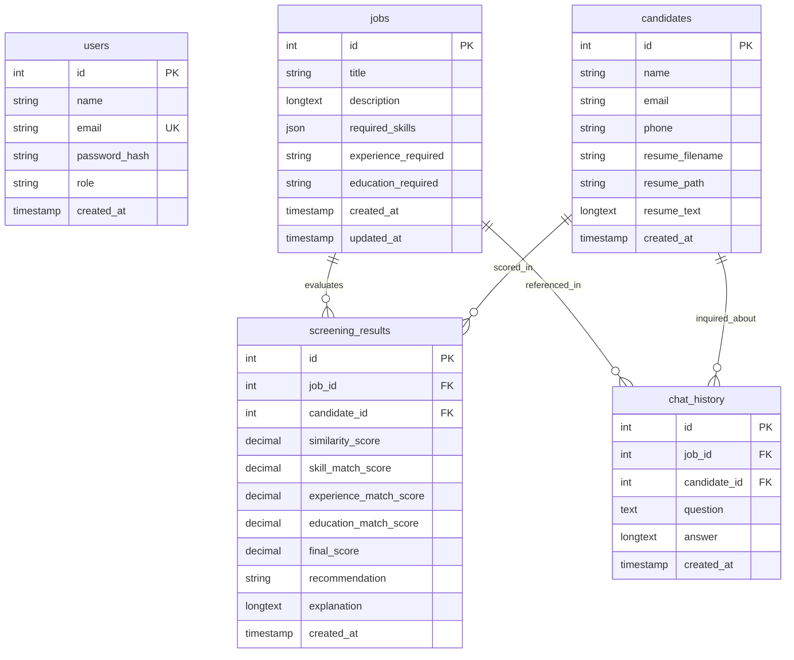

# Smart Screen AI — Database Documentation

## 1. Relational ER Diagram

## 2. Table Schemas

### `users`
* `id`: Auto-incrementing primary key.
* `name`: Recruiter or administrator name.
* `email`: Unique email address.
* `password_hash`: Bcrypt hashed password (plain text passwords never stored).
* `role`: User role (`recruiter`, `admin`).
* `created_at`: Account creation timestamp.

### `jobs`
* `id`: Auto-incrementing primary key.
* `title`: Position title (e.g., "Python Full Stack Developer").
* `description`: Detailed job description text.
* `required_skills`: JSON array of required skills.
* `experience_required`: Experience requirement (e.g. "Fresher", "2-4 years").
* `education_required`: Minimum education level (e.g. "B.Tech / MCA").
* `created_at` / `updated_at`: Timestamps.

### `candidates`
* `id`: Auto-incrementing primary key.
* `name`: Parsed candidate name.
* `email`: Parsed candidate email.
* `phone`: Parsed candidate phone.
* `resume_filename`: Sanitized filename on disk.
* `resume_path`: Path to file inside `uploads/`.
* `resume_text`: Cleaned text extracted from resume.
* `created_at`: Upload timestamp.

### `screening_results`
* `id`: Auto-incrementing primary key.
* `job_id`: Foreign key reference to `jobs(id)`.
* `candidate_id`: Foreign key reference to `candidates(id)`.
* `similarity_score`: Dense vector cosine similarity score (0 - 100).
* `skill_match_score`: Skill overlap score (0 - 100).
* `experience_match_score`: Experience alignment score (0 - 100).
* `education_match_score`: Education criteria score (0 - 100).
* `final_score`: Weighted overall screening score (0 - 100).
* `recommendation`: Decision-support tag (`Strong Match`, `Potential Match`, `Low Match`).
* `explanation`: Grounded textual justification explaining matched & missing attributes.
* `created_at`: Screening execution timestamp.

### `chat_history`
* `id`: Auto-incrementing primary key.
* `job_id`: Optional foreign key reference to `jobs(id)`.
* `candidate_id`: Optional foreign key reference to `candidates(id)`.
* `question`: Recruiter inquiry.
* `answer`: Grounded assistant answer.
* `created_at`: Query timestamp.
