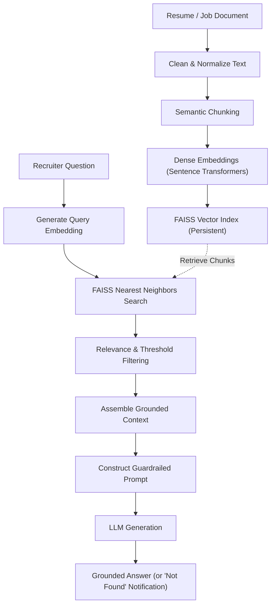

# Smart Screen AI — RAG & Retrieval Architecture

## 1. Overview

Smart Screen AI employs a Retrieval-Augmented Generation (RAG) architecture to answer recruiter questions accurately and generate transparent screening justifications. Answers are strictly grounded in document text to prevent hallucinations.

## 2. Guardrails Against Hallucination

1. **Direct Context Grounding**: The LLM is provided exclusively with the top-k retrieved resume chunks.
2. **Missing Information Policy**: If a recruiter asks a question about details not present in the candidate's resume (e.g., "What is their favorite movie?"), the system explicitly responds:
   > *"I don't have enough information in the uploaded resume or job documents to answer that."*
3. **No Unwarranted Inferences**: The model does not extrapolate salary predictions, sensitive demographic details, or unlisted certifications.
